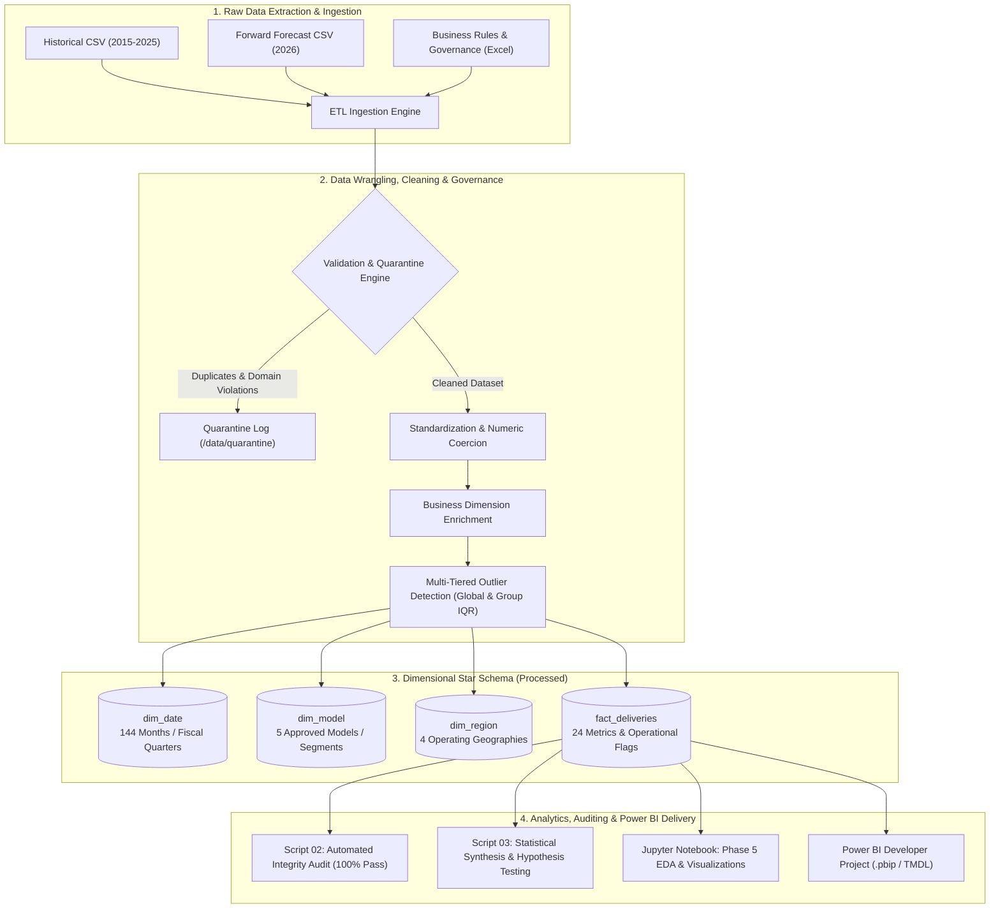
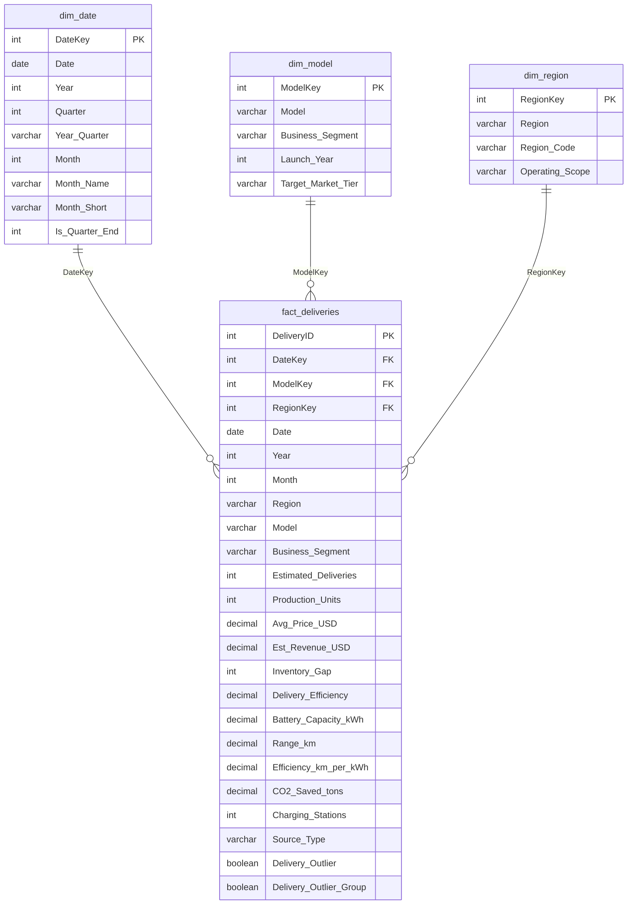

# 🚗 Tesla Global Deliveries & Business Performance Analytics

[](https://www.python.org/)
[](https://powerbi.microsoft.com/)
[](https://pandas.pydata.org/)
[](https://scipy.org/)
[](#-data-architecture--star-schema)
[](LICENSE)

An enterprise-grade, end-to-end business intelligence and data engineering initiative analyzing Tesla’s commercial delivery volume, production balance, pricing dynamics, charging infrastructure expansion, and environmental impact across global operating markets from **2015 through 2026**.

---

## 📌 Executive Summary & Key Metrics (2015 – 2026)

Based on a consolidated multi-partition historical and forward-horizon dataset spanning **12 years (144 operating months)** across **5 vehicle models** and **4 primary continental sales regions**:

| Metric | Portfolio Total / Benchmark | Commercial Context |
| :--- | :--- | :--- |
| **Total Global Deliveries** | **28,013,288 units** | Led by Model Y (23.0%) and Model 3 (21.0%) |
| **Total Global Production** | **29,939,472 units** | Scaled across Fremont, Shanghai, Berlin, and Austin Gigafactories |
| **Delivery-to-Production Efficiency** | **93.57%** | Significant longitudinal jump: 93.24% (2015–2020) → **96.42% (2021–2026)** |
| **Net Finished Inventory Buffer** | **1,926,184 units** | Strategic in-transit pipeline buffer and delivery hub staging |
| **Portfolio Average Selling Price (ASP)** | **\$83,535.79** | Statistically consistent pricing across international operating zones |
| **Cumulative Estimated Gross Revenue** | **\$2.30 Trillion USD** | Delivery volume multiplied by model-region ASP |
| **Cumulative Environmental Offset** | **2,184,319.8 metric tons CO₂** | Lifetime EV deployment carbon displacement calculation |

---

## 🏢 Business Context & Core Challenges

Tesla markets five primary passenger and commercial vehicle platforms (**Model S, Model 3, Model X, Model Y, and Cybertruck**) across four key geographic theaters (**North America, Europe, Asia, and Middle East**).

Prior to this analytics initiative, operational and commercial leadership faced several key challenges:
1. **Siloed Historical vs. Forward Data:** Historical deliveries (2015–2025) and forward operating projections (2026) were partitioned across disparate formats without standardized dimension keys or automated quality control.
2. **Delivery-Production Synchronization Gaps:** Periodic delivery surges caused temporary regional stockouts, while negative inventory gaps (*deliveries exceeding monthly factory output*) obscured transit pipeline inventory mechanics.
3. **Unverified Industry Folklore:** Assumptions surrounding *quarter-end delivery rushes*, *regional pricing disparities*, and the direct revenue elasticity of *Supercharger infrastructure* were unverified through rigorous inferential statistics.
4. **Data Governance & Synthetic Artifacts:** Public web-scraped and open-source EV delivery data contained synthetic backfills (e.g., historical Cybertruck records pre-dating commercial launch on Nov 30, 2023) that required transparent business governance and quarantine isolation.

---

## 🏗️ System Architecture & Workflow Pipeline



---

## 🗄️ Data Architecture & Star Schema

The data model conforms to Kimball dimensional modeling principles, separating operational measures into a central fact table bounded by conformant dimensions:



### Table Specifications:
- **`fact_deliveries` (2,880 rows, 24 columns):** Grain is **1 record per Model, Region, and Year-Month**. Captures delivery volume, production output, revenue, inventory gap, efficiency ratios, vehicle engineering specs, and outlier audit flags.
- **`dim_date` (144 rows):** Continuous monthly calendar from January 2015 through December 2026, containing fiscal quarter mappings, short names, and quarter-end push flags (`Is_Quarter_End`).
- **`dim_model` (5 rows):** Catalog of official production vehicles with governance segment classifications (`Premium` vs. `To classify`), official commercial launch dates, and market tiers.
- **`dim_region` (4 rows):** Standardized continental clusters (`North America [NA]`, `Europe [EU]`, `Asia [APAC]`, `Middle East [ME]`) mapped to regional operating scopes.

---

## ⚙️ Engineering & Quality Governance

The production ETL pipeline (`scripts/01_etl_pipeline.py`) and post-ETL integrity suite (`scripts/02_data_validation.py`) implement enterprise-level data quality controls:

1. **Automated Partition Concatenation:** Merges historical records (2015–2025) and projections (2026) with automated schema-header assertions.
2. **Domain Boundaries & Quarantine Logging:**
   - Any record with negative deliveries, negative production, or non-positive price is isolated to `data/quarantine/invalid_records.csv`.
   - Primary business key uniqueness (`Year` + `Month` + `Region` + `Model`) is enforced. Deduplication captures and archives duplicate snapshots to `data/quarantine/duplicate_records.csv`.
3. **Multi-Tiered Outlier Detection:**
   - **Global IQR:** Flags cross-market macro anomalies on delivery volume ($Q_1 - 1.5 \times IQR$ to $Q_3 + 1.5 \times IQR$).
   - **Grouped Regional IQR:** Computes localized outlier thresholds segmented by Model and Regional geography to detect regional operational spikes without global bias.
4. **Automated Post-ETL Audit Suite (100% Pass Rate):**
   - ✅ Referential Integrity: `DateKey`, `ModelKey`, and `RegionKey` complete alignment (0 unmatched foreign keys).
   - ✅ Completeness: Zero null values across all 24 attributes in `fact_deliveries`.
   - ✅ Volumetric Reconciliation: Raw source deliveries and production match `fact_deliveries` exactly with zero variance.
   - ✅ Financial Parity: Automated re-calculation confirms `Est_Revenue_USD == Estimated_Deliveries * Avg_Price_USD` across all records.

---

## 🧪 Statistical Hypothesis Testing & Empirical Findings

Using `scipy.stats` in Phase 5 (`notebook/02_eda_and_tests.ipynb` and `scripts/03_analysis.py`), four formal inferential tests were executed against core BRD business questions:

```
+-------------------------------------------------------------------------------------------------------+
|  Test 1: Quarter-End Delivery Surge Effect (Welch's Two-Sample t-test)                                |
|  • H0: Mean deliveries in Q-End months (Mar, Jun, Sep, Dec) == Non-Q-End months                       |
|  • Q-End Mean: 9,923.8 units | Non-Q-End Mean: 9,628.3 units                                          |
|  • Welch's t = 1.2525 | p-value = 0.2106                                                             |
|  • Decision: FAIL TO REJECT H0. No statistically significant quarter-end volume difference.           |
+-------------------------------------------------------------------------------------------------------+
|  Test 2: Regional Pricing Parity (One-Way ANOVA across 4 Operating Regions)                           |
|  • H0: Mean vehicle selling price is identical across NA, EU, Asia, and ME                           |
|  • F-statistic = 1.9358 | p-value = 0.1216                                                            |
|  • Decision: FAIL TO REJECT H0. Tesla maintains globally uniform MSRP parity across regions.          |
+-------------------------------------------------------------------------------------------------------+
|  Test 3: Charging Infrastructure vs. Vehicle Deliveries (Pearson Correlation)                         |
|  • H0: Correlation between regional charging stations and vehicle deliveries == 0                    |
|  • Pearson r = +0.0852 | p-value = 4.72e-06                                                           |
|  • Decision: REJECT H0. Statistically significant positive association between Superchargers & sales. |
+-------------------------------------------------------------------------------------------------------+
|  Test 4: Longitudinal Manufacturing Efficiency Shift (2015-2020 vs. 2021-2026)                        |
|  • H0: Mean delivery efficiency in early era (2015-2020) == mature Gigafactory era (2021-2026)        |
|  • Early Era Mean: 93.24% | Mature Era Mean: 96.42% (+3.18% absolute gain)                           |
|  • Welch's t = 11.4418 | p-value = 2.44e-29                                                           |
|  • Decision: REJECT H0. Highly significant structural improvement in global logistics throughput.     |
+-------------------------------------------------------------------------------------------------------+
```

---

## 📊 Executive Power BI Dashboard Architecture

The dashboard is structured using Microsoft Power BI Project (`.pbip`) format with Tabular Model Definition Language (**TMDL**) and an executive dark aesthetic (`Tesla_Dark_Theme.json`):

### Dashboard Pages
1. **`Home`:** Executive portal featuring navigational action tiles, project background, model portfolio cards, and BRD document governance references.
2. **`Executive Overview`:** 
   - High-level KPI cards: Total Deliveries, Total Production, Estimated Revenue, Average Selling Price, Delivery Efficiency, and Net Inventory Gap.
   - Monthly longitudinal trend curves with interactive slicers (Year, Model, Region).
   - Regional volume share decomposition (Donut and Matrix layouts).
3. **`Product & ESG Analytics`:**
   - Engineering metrics: Average Battery Capacity ($kWh$), Average Range ($km$), and Powertrain Efficiency ($km/kWh$).
   - Environmental Impact: Cumulative $CO_2$ metric tons offset by product line.
   - Infrastructure correlation matrix: Charging station growth vs. regional adoption velocity.

### Structured DAX Measure Folders
* **`1 Executive Overview`:**
  - `[Total Deliveries]` = `SUM(fact_deliveries[Estimated_Deliveries])`
  - `[Total Production]` = `SUM(fact_deliveries[Production_Units])`
  - `[Est. Revenue]` = `SUM(fact_deliveries[Est_Revenue_USD])`
  - `[Avg Selling Price]` = `DIVIDE([Est. Revenue], [Total Deliveries])`
  - `[Delivery Efficiency]` = `DIVIDE([Total Deliveries], [Total Production])`
  - `[Inventory Gap]` = `[Total Production] - [Total Deliveries]`
  - `[Est. Revenue (KPI)]` = Formatted string variant ($B / $M scaling)
* **`2 Product & ESG`:**
  - `[Avg Battery Capacity (kWh)]` = `AVERAGE(fact_deliveries[Battery_Capacity_kWh])`
  - `[Avg Driving Range (km)]` = `AVERAGE(fact_deliveries[Range_km])`
  - `[Estimated CO2 Savings (t)]` = `SUM(fact_deliveries[CO2_Saved_tons])`
  - `[Charging Stations]` = Dynamic scalar Supercharger network snapshot per active region

---

## 💡 Strategic Business Insights & Recommendations

The analytical findings were synthesized into actionable executive intelligence using the **Observation $\rightarrow$ Evidence $\rightarrow$ Business Implication $\rightarrow$ Strategic Recommendation** framework:

### 1. Mass-Market Volume & Cash Flow Concentration
* **Observation:** Commercial volume and top-line cash generation are overwhelmingly concentrated in two core vehicles.
* **Evidence:** **Model Y** (6.43M units; 23.0% share) and **Model 3** (5.89M units; 21.0% share) collectively account for **44.0% of all deliveries** and **\$975.9 Billion** in revenue.
* **Implication:** The company is exposed to product lifecycle concentration risk. Aggressive price cuts by competing OEMs in the mass-market crossover/sedan segments directly pressure Tesla's core operating margins.
* **Recommendation:** Defend market leadership through continuous localized Gigafactory manufacturing optimizations, while updating styling and battery architecture for flagship platforms (Model S/X) to revitalize premium market share.

### 2. Finished-Goods Buffer & Intercontinental Transit Pipelines
* **Observation:** Deliveries systematically exceed factory manufacturing volumes in specific operating months.
* **Evidence:** In **216 monthly records (7.5% of the portfolio)**, `Estimated_Deliveries > Production_Units` (negative inventory gap). Total portfolio delivery efficiency is 93.57%, preserving an overall cumulative manufactured buffer of 1.93M units over 12 years.
* **Implication:** Negative gaps demonstrate that regional delivery hubs actively buffer handovers using maritime transit stock and finished-vehicle holding yards rather than pure just-in-time handoffs.
* **Recommendation:** Deploy dynamic inventory staging algorithms across port storage yards to minimize holding costs while preventing localized stockouts during peak delivery windows.

### 3. Supply Chain Regionalization Drives Operational Velocity
* **Observation:** Vehicle delivery speed from factory floor to end customer has tightened dramatically.
* **Evidence:** Mean delivery efficiency surged from **93.24% in the early production era (2015–2020)** to **96.42% in the mature era (2021–2026)** ($t = 11.44, p = 2.44 \times 10^{-29}$).
* **Implication:** The commissioning of Gigafactory Shanghai and Gigafactory Berlin localized production for primary consumption zones, drastically cutting the transit lead-times previously required when exporting exclusively from Fremont, California.
* **Recommendation:** Accelerate localized component sourcing and regional battery assembly to further insulate global deliveries from geopolitical maritime disruptions.

### 4. Synthetic Backfill Governance & Data Integrity
* **Observation:** Uncurated public EV datasets contain synthetic backfilled artifacts.
* **Evidence:** Cybertruck monthly records appear from 2015 to 2023 despite initial customer handovers officially occurring on November 30, 2023. Over 67% of monthly regional records bear `Interpolated` or `Estimated` source labels.
* **Implication:** Unfiltered reporting to senior leadership would distort commercial reality and erode analytical credibility.
* **Recommendation:** Enforce transparent metadata governance. All executive reporting reflects audit flags indicating that pre-launch model timelines represent simulated/synthetic estimates per BRD Section 5 & 11.

---

## 📂 Repository Directory Structure

```plaintext
tesla_gobal_deliveries_analytics/
│
├── dashboard/                                   # Power BI Developer Assets
│   ├── tesla_analytics_dashboard.pbip          # Power BI Project root file
│   ├── tesla_analytics_dashboard.Report/       # Visual report definitions & layout
│   │   └── definition/
│   │       ├── pages/                          # Home, Exec Overview, Product & ESG
│   │       └── report.json
│   ├── tesla_analytics_dashboard.SemanticModel/# TMDL Semantic data model
│   │   └── definition/
│   │       ├── tables/                         # fact_deliveries, dim_date, etc.
│   │       ├── relationships.tmdl              # Star schema relationship joins
│   │       └── model.tmdl
│   └── tesla_analytics_dashboard.themes/
│       └── Tesla_Dark_Theme.json               # Custom enterprise dark theme
│
├── data/
│   ├── raw/                                    # Raw multi-partition sources & rules
│   │   ├── tesla_deliveries_dataset_2015_2025.csv
│   │   ├── tesla_deliveries_dataset_2026.csv
│   │   └── business_rules.xlsx                 # Model classification & regional scope
│   ├── quarantine/                             # Data quality quarantine isolation
│   │   ├── duplicate_records.csv
│   │   └── invalid_records.csv
│   ├── processed/                              # Star schema production tables
│   │   ├── fact_deliveries.csv                 # 2,880 rows x 24 columns
│   │   ├── dim_date.csv                        # 144 calendar months
│   │   ├── dim_model.csv                       # 5 vehicle platforms
│   │   └── dim_region.csv                      # 4 operating theaters
│   └── working/                                # Pipeline execution & audit logs
│
├── documents/
│   └── Tesla_BRD.pdf                           # Official Business Requirements Document
│
├── notebook/
│   └── 02_eda_and_tests.ipynb                  # Phase 5 EDA, statistical tests, charts
│
├── scripts/
│   ├── 01_etl_pipeline.py                      # Production extraction, transformation & load
│   ├── 02_data_validation.py                   # Post-ETL automated integrity & sanity audit
│   └── 03_analysis.py                          # Statistical hypothesis & KPI reporting engine
│
├── .gitignore
├── LICENSE                                     # MIT License
└── README.md                                   # Comprehensive project documentation
```

---

## 🚀 Quickstart & Execution Guide

### 1. Prerequisites & Environment Setup
Clone this repository and ensure Python 3.10+ is installed:
```bash
git clone https://github.com/Yes20sh/tesla_gobal_deliveries_analytics.git
cd tesla_gobal_deliveries_analytics
python -m venv venv
# On Windows:
.\venv\Scripts\activate
# On macOS/Linux:
source venv/bin/activate

pip install pandas numpy scipy openpyxl jupyter
```

### 2. Execute Data Pipeline & Audits
Run the three-stage analytical workflow sequentially:

```bash
# Step 1: Run Production ETL (generates star schema and quarantine logs)
python scripts/01_etl_pipeline.py

# Step 2: Run Post-ETL Integrity Audit (verifies referential integrity & business logic)
python scripts/02_data_validation.py

# Step 3: Run Statistical Synthesis (outputs portfolio KPIs and hypothesis test statistics)
python scripts/03_analysis.py
```

### 3. Launch Exploratory Notebook
To interact with detailed visualizations, distributions, and inferential tests:
```bash
jupyter notebook notebook/02_eda_and_tests.ipynb
```

### 4. Open Power BI Dashboard
Open `dashboard/tesla_analytics_dashboard.pbip` using **Power BI Desktop** (November 2023 release or newer with PBIP and TMDL support enabled).

---

## 👨‍💻 Project Metadata & Authorship

- **Author:** Yashraj Singh Solanki
- **LinkedIn:** [@Yes20sh](https://www.linkedin.com/in/Yes20sh)
- **Role:** Data Engineering & Analytics Lead
- **Project Initiative:** Tesla Global Deliveries & Business Performance Analytics Initiative
- **Project Classification:** Educational & Portfolio Analytics Project – *Not an official publication of Tesla, Inc.*

---

## ⚖️ License & Disclaimer

This project is open-sourced under the [MIT License](LICENSE). 

*Disclaimer: This repository is developed solely for educational, portfolio, and analytical demonstration purposes using open-source, publicly accessible datasets. All trademarks, vehicle model designations, and brand names belong to Tesla, Inc.*
